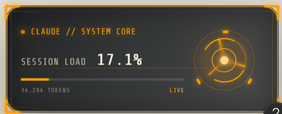
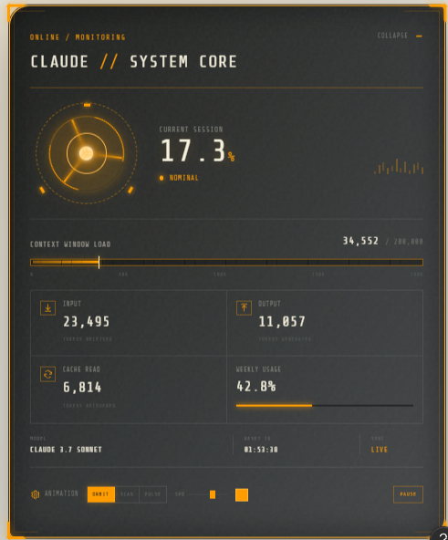

# Claude Usage Float (Windows)

A compact, always-on-top Claude Code usage widget built with Python + PySide6. Monitor Claude Code usage through a floating desktop interface with customizable themes, opacity, size, and refresh settings.

## Features

- Floating, draggable, frameless widget
- Dark glass-style appearance with Claude orange accent
- Theme, accent color, background, opacity, and size customization
- Background `QThread` worker for CLI polling
- Adjustable refresh cadence (15–300 seconds)
- System tray menu and manual refresh
- Settings saved under `%APPDATA%\ClaudeUsageFloat\settings.json`

## Screenshots

### Floating Widget

The compact, always-on-top widget provides quick visibility into Claude Code usage without interrupting your workflow.

.png)

### Expanded Usage Panel

Click the floating widget to expand and view detailed usage information.



### Settings and Customization

Customize the appearance and behavior of the widget, including theme, accent color, opacity, size, and refresh interval.



## Important Usage Retrieval Note

The worker currently attempts:

```bash
claude -p "/usage" --output-format json
```

It conservatively parses common percentage patterns.

Claude Code versions may differ in whether `/usage` is exposed in print mode and in the output format. Verify the command on your installed CLI before treating values as authoritative.

This polling path may invoke a CLI turn in some versions. Do not enable frequent polling until you have confirmed that it does not consume model usage.

If unsupported, replace `UsageWorker.run()` with a confirmed non-token-consuming usage endpoint or command.

## Setup

### Prerequisites

1. Python 3.11+
2. Claude Code CLI installed separately
3. Claude Code CLI authenticated

### Installation

Open PowerShell in the project folder:

```powershell
python -m venv .venv
.\.venv\Scripts\Activate.ps1
pip install -r requirements.txt
python app.py
```

### Usage

1. Launch the application.
2. Drag the widget to your preferred screen location.
3. Click the widget to expand usage details.
4. Right-click or click the gear icon to customize settings.
5. Use the system tray menu for manual refresh and application controls.

## Build EXE

Run:

```powershell
build_exe.bat
```

Output:

```text
dist\ClaudeUsageFloat.exe
```

## Project Structure

```text
ClaudeUsageFloat/
│
├── app.py
├── requirements.txt
├── build_exe.bat
├── README.md
│
└── screenshots/
    ├── widget.png
    ├── expanded.png
    ├── settings.png
    └── tray.png
```

## Limitations

- Usage output parsing is intentionally conservative; the format needs validation against your local CLI.
- Reset time currently displays a textual reset hint rather than a ticking countdown.
- Widget position is loaded at startup; persistent drag-position saving can be added.
- Click-through behavior is not currently implemented.
- Widget supports theme presets, hex colors, opacity, size, and refresh interval.

## Technology Stack

- Python 3.11+
- PySide6
- Claude Code CLI
- Qt Threads (`QThread`)
- PyInstaller

## License

Add your preferred license here.
